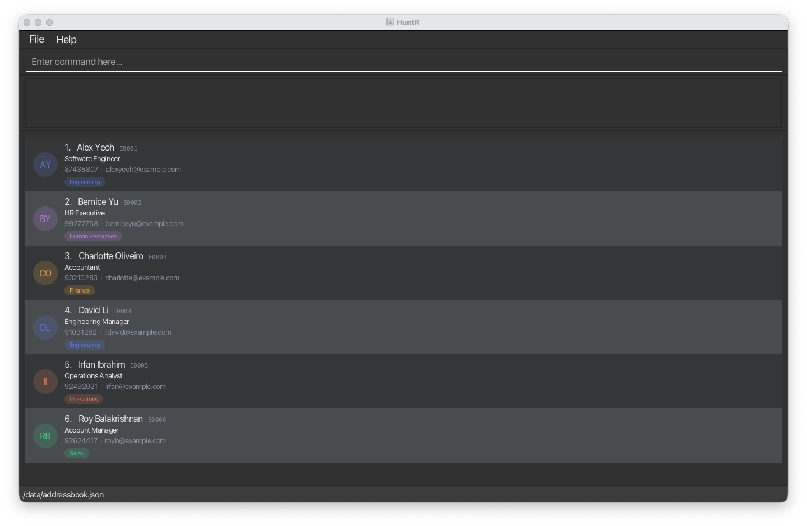
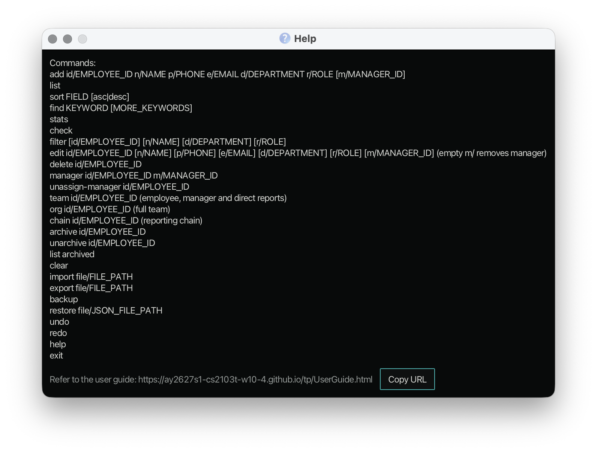
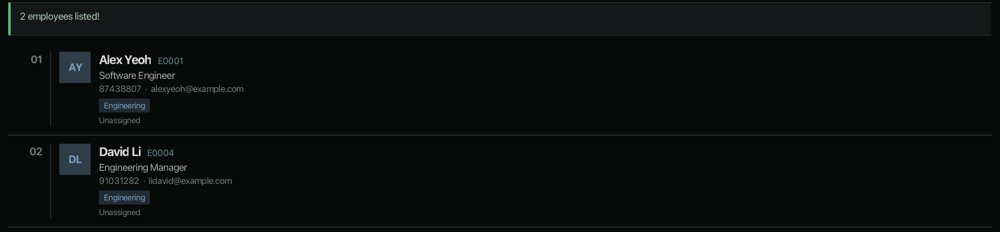

# HuntR User Guide

HuntR is a **desktop application for a sole HR administrator to manage employee records, optimised for use through a Command Line Interface (CLI)** while retaining the benefits of a Graphical User Interface (GUI). If you can type quickly, HuntR can help you add, find, update and remove employee records faster than traditional GUI-based HR tools.

HuntR is based on [AddressBook-Level3](https://github.com/se-edu/addressbook-level3) from SE-EDU. This guide covers version 1.3.

<!-- * Table of Contents -->
<page-nav-print />

--------------------------------------------------------------------------------------------------------------------

## Quick start

1. Ensure that Java `25` or later is installed on your computer.<br>
   **Mac users:** Ensure you have the precise JDK version prescribed [here](https://se-education.org/guides/tutorials/javaInstallationMac.html).

1. Download the latest `huntr.jar` file from [here](https://github.com/AY2627S1-CS2103T-W10-4/tp/releases).

1. Copy the file to the folder you want to use as the _home folder_ for HuntR.

1. Open a terminal, `cd` to the folder containing the JAR file, and run `java -jar huntr.jar`.<br>
   A GUI similar to the one below should appear in a few seconds. Note how the app contains some sample data.<br>
   

1. Type a command in the command box and press Enter to execute it. For example, type **`help`** and press Enter to open the help window.<br>
   Some example commands you can try:

   * `list` : Lists all employees.

   * `add id/E0123 n/John Tan p/91234567 e/johntan@example.com d/Engineering r/Software Engineer` : Adds an employee named `John Tan` to HuntR.

   * `edit id/E0123 p/92345678 r/Senior Software Engineer` : Updates the phone number and role of employee `E0123`.

   * `find Alex` : Finds employees whose names contain the word `Alex`.

   * `filter d/Engineering r/Manager` : Shows only the employees in the Engineering department whose role contains `Manager`.

   * `delete id/E0123` : Deletes employee `E0123`, including when hidden by a search.

   * `clear` : Deletes all employees.

   * `exit` : Exits the app.

1. Refer to the [Features](#features) section below for details of each command.

--------------------------------------------------------------------------------------------------------------------

## Features

<box type="info" seamless>

**Notes about the command format:**<br>

* Words in `UPPER_CASE` are the parameters to be supplied by the user.<br>
  For example, in `add id/EMPLOYEE_ID n/NAME`, replace `EMPLOYEE_ID` and `NAME` with values such as `E0123` and `John Doe`.

* Items in square brackets are optional.<br>
  For example, `edit id/EMPLOYEE_ID [p/PHONE]` can be used as `edit id/E0001 p/91234567`.

* Parameters can be in any order.<br>
  For example, if the command specifies `n/NAME p/PHONE`, `p/PHONE n/NAME` is also acceptable.

* Extraneous parameters for `help` and `clear` are ignored.<br>
  For example, `help 123` is interpreted as `help`. The `list` and `exit` commands also take no parameters but reject extra text, so `list 1` and `exit now` show an error.

* If you are using a PDF version of this document, be careful when copying and pasting commands that span multiple lines as space characters surrounding line-breaks may be omitted when copied over to the application.
</box>

### Viewing help: `help`

Opens a help window that lists the format of every command and links to this user guide.



Format: `help`

* Click **Copy URL** to copy the link to this user guide.
* You can also open the help window by pressing <kbd>F1</kbd> or choosing **Help** in the menu bar.


### Adding an employee: `add`

Adds an employee to HuntR.

Format: `add id/EMPLOYEE_ID n/NAME p/PHONE e/EMAIL d/DEPARTMENT r/ROLE`

All six fields are required. The employee ID must be 1 to 20 characters long and contain only letters, digits,
hyphens and underscores. Employee IDs are compared case-insensitively, so `E0123` and `e0123` identify the
same employee. For example, if `E0123` is already in use, HuntR displays
`An employee with Employee ID E0123 already exists.` and does not add the employee.

Parameters can be supplied in any order.

Examples:
* `add id/E0123 n/John Tan p/91234567 e/johntan@example.com d/Engineering r/Software Engineer`
* `add id/EMP-0042 n/Nur Aisyah p/87654321 e/nur.aisyah@example.com d/Human Resources r/HR Executive`
* `add id/2024-017 n/Marcus Lee p/90001111 e/marcus.lee@example.com d/Finance r/Accountant`

### Listing all employees: `list`

Shows all employees stored in HuntR as a numbered list. Each entry includes the employee's name, employee ID,
phone number, email, department, and role.

Format: `list`

The command takes no parameters. Leading and trailing spaces are ignored, but additional text is rejected.

If there are no employee records, HuntR displays an empty employee list and explains how to add an employee.

Use `list` to show every employee again after a `find` or `filter`.

### Editing an employee: `edit`

Edits an existing employee in HuntR using their employee ID.

Format: `edit id/EMPLOYEE_ID [n/NAME] [p/PHONE] [e/EMAIL] [d/DEPARTMENT] [r/ROLE]`

* At least one of the optional fields must be provided.
* Existing values will be updated to the input values.
* The `id/` parameter identifies the employee to edit. The employee ID itself cannot be changed.
* Employee ID matching is case-insensitive: `edit id/e0001 ...` identifies employee `E0001`.
* HuntR searches the complete employee roster, so an employee hidden by the current `find` result can still be edited.
* After a successful edit, HuntR resets the list to show all employees, clearing any active `find` result.
* If an employee ID such as `E9999` does not exist, HuntR displays `No employee with ID E9999 was found.` and does not change any records.

Examples:
* `edit id/E0001 p/91234567 e/alex@example.com` updates the phone number and email address of employee `E0001`.
* `edit id/e0002 r/HR Manager` updates the role of employee `E0002`, using case-insensitive ID matching.

### Finding employees by name: `find`

Finds employees whose names contain any of the given keywords and displays them in the employee list.

Format: `find KEYWORD [MORE_KEYWORDS]`

* The search is case-insensitive; for example, `hans` matches `Hans`.
* Keyword order does not matter; for example, `Hans Bo` matches `Bo Hans`.
* The search considers only names.
* Only full words match; for example, `Han` does not match `Hans`.
* Employees matching at least one keyword are returned (an `OR` search); for example, `Hans Bo` returns `Hans Gruber` and `Bo Yang`.
* At least one non-blank keyword must be provided.
* Each keyword must start with a letter or digit. Apostrophes, full stops, commas, slashes and hyphens are allowed
  after the first character.
* An argument beginning with `/` is rejected as an invalid command format.
* A search with no matching name is still valid.
* Leading and trailing spaces are ignored, and multiple spaces between keywords are treated as separators.
* A search with no matches is successful and displays an empty employee list.

Examples:
* `find John` returns employees named `john` and `John Doe`
* `find alex david` returns `Alex Yeoh`, `David Li`<br>
  

### Filtering employees by department and role: `filter`

Shows only the employees whose department and role match all the values you give.

Format: `filter [d/DEPARTMENT] [r/ROLE]`

* At least one of `d/` or `r/` must be given. If you give both, an employee must match **both** (an `AND` search), so the list is narrowed further.
* Matching is case-insensitive and uses whole words, like `find`. For example, `d/engineering` matches `Engineering`, and `d/Resources` matches `Human Resources`, but `d/Engineer` does not match `Engineering`.
* If a value has several words, every word must appear in that field, in any order. For example, `r/Software Engineer` matches `Software Engineer` but not `Software Manager`.
* Only the department and the role can be filtered. To search by name, use [`find`](#finding-employees-by-name-find).
* Filtering only changes what is shown. Your saved data is not changed. Use [`list`](#listing-all-employees-list) to show all employees again.
* A filter with no matches is valid and shows an empty list with the message `0 employees listed!`.
* Leading and trailing spaces are ignored, and the parameters can be in any order.

Examples:
* `filter d/Engineering` shows everyone in the Engineering department.
* `filter r/Manager` shows employees whose role contains the word `Manager`, such as `Engineering Manager`.
* `filter d/Engineering r/Manager` shows only the Engineering employees whose role contains `Manager`.

The following input errors leave the displayed list unchanged. Each message is followed by the usage of the command.

| Input | Error message |
| --- | --- |
| `filter` or `filter Engineering` | `Invalid command format!` |
| `filter n/John` or `filter x/foo` | `Unknown parameter: n/` (or the parameter given) |
| `filter d/` or `filter r/` | `Department should not be blank.` (or `Role should not be blank.`) |
| `filter d/@@@` | The department constraints message |
| `filter d/Sales d/Finance` | `Multiple values specified for the following single-valued field(s): d/` |

### Deleting an employee: `delete`

Permanently deletes one employee from the complete roster using their employee ID.

Format: `delete id/EMPLOYEE_ID`

* Employee IDs contain 1 to 20 letters, digits, hyphens or underscores, with no spaces. For example, `E0001`, `EMP-0042`, `2024-017`, `abc` and `e0123` are valid.
* ID matching ignores letter case: `e0123` identifies the same employee as `E0123`. The success message shows the ID as stored.
* Supply exactly one `id/` parameter. Surrounding spaces and tabs are accepted; spaces within an ID, repeated `id/` parameters and other parameters are rejected.
* The command searches all employee records, including employees hidden by `find`. Employees may share a name; deletion uses only the ID.
* The current search filter and the order of remaining employees are preserved.
* Deletion is immediate, with no confirmation or undo. The final employee can be deleted, and a deleted ID can be reused.

Examples, assuming the target employee exists:

* `delete id/EMP-0042` deletes employee `EMP-0042`.
* `delete id/e0123` deletes employee `E0123`.
* `find Betsy` followed by `delete id/EMP-0042` deletes `EMP-0042` even when hidden by that search. The Betsy search remains active.

On success, the message starts with `Deleted employee:` and includes the deleted employee's ID, name, phone, email, department and role.

The following input errors leave the records unchanged. Each message is followed by the usage block below.

| Input | Error message |
| --- | --- |
| `delete` or `delete 1` | `Missing parameter: id/EMPLOYEE_ID.` |
| `delete id/` or a whitespace-only ID | `Employee ID cannot be blank.` |
| `delete x/value` or `delete id/abc x/value` | `Unknown parameter: x/. Only id/ is supported.` |
| `delete id/abc!`, `delete id/abc def` or an ID longer than 20 characters | `Employee ID should be 1 to 20 characters long and contain only letters, digits, hyphens and underscores.` |
| `delete id/abc id/abc` | `Multiple values specified for the following single-valued field(s): id/` |
| `delete extra id/abc` | `Unexpected arguments. Specify exactly one employee ID using id/EMPLOYEE_ID.` |

```text
delete: Deletes one employee by employee ID from all stored employee records.
Parameters: id/EMPLOYEE_ID
Employee ID should be 1 to 20 characters long and contain only letters, digits, hyphens and underscores.
Example: delete id/EMP-0042
```

A valid ID that does not exist produces `No employee with ID EMP-0042 was found.` (using the entered ID), without the usage block. No records are changed. This also applies to deleting an employee twice or deleting from an empty roster.

### Clearing all employees: `clear`

Clears all employee records from HuntR.

Format: `clear`

<box type="warning" seamless>

**Caution:** There is no confirmation and no undo. After `clear`, the empty list is saved immediately.
</box>

### Exiting the program: `exit`

Closes HuntR. Your employee records are saved after every command, so nothing is lost when you exit.

Format: `exit`

The command takes no parameters, and extra text such as `exit now` is rejected.

### Saving the data

HuntR automatically saves data after every command. You do not need to save manually.

### Editing the data file

HuntR data is saved automatically as a JSON file `[JAR file location]/data/addressbook.json`. Advanced users are welcome to update data directly by editing that data file.

Every employee in the file must follow the same rules as the `add` command, and no two employees may have the same employee ID (ignoring letter case).

<box type="warning" seamless>

**Caution:**
If your changes make the data file invalid, HuntR rejects the whole file (it does not load only the valid employees) and starts with an empty employee list at the next run. The invalid file remains on disk until you run a command (HuntR saves after every command, which then overwrites it). Therefore, always back up the file before editing it.<br>
Furthermore, certain edits can cause HuntR to behave in unexpected ways (e.g., if a value entered is outside of the acceptable range). Therefore, edit the data file only if you are confident that you can update it correctly.
</box>

--------------------------------------------------------------------------------------------------------------------

## FAQ

**Q**: How do I transfer my data to another computer?<br>
**A**: Install the app on the other computer, run it, enter any command (such as `list`) so that the data file is created, and exit. Then overwrite that data file (`data/addressbook.json`) with the data file from your previous HuntR home folder.

--------------------------------------------------------------------------------------------------------------------

## Known issues

1. **When using multiple screens**, if you move the application to a secondary screen, and later switch to using only the primary screen, the GUI will open off-screen. The remedy is to delete the `preferences.json` file created by the application before running the application again.
2. **If you minimize the Help Window** and then run the `help` command (or use the `Help` menu, or the keyboard shortcut `F1`) again, the original Help Window will remain minimized, and no new Help Window will appear. The remedy is to manually restore the minimized Help Window.

--------------------------------------------------------------------------------------------------------------------

## Command summary

Action     | Format, Examples
-----------|----------------------------------------------------------------------------------------------------------------------------------------------------------------------
**Add**    | `add id/EMPLOYEE_ID n/NAME p/PHONE e/EMAIL d/DEPARTMENT r/ROLE`<br>e.g., `add id/E0123 n/John Tan p/91234567 e/johntan@example.com d/Engineering r/Software Engineer`
**Clear**  | `clear`
**Delete** | `delete id/EMPLOYEE_ID`<br> e.g., `delete id/EMP-0042`
**Edit**   | `edit id/EMPLOYEE_ID [n/NAME] [p/PHONE] [e/EMAIL] [d/DEPARTMENT] [r/ROLE]`<br>e.g., `edit id/E0001 p/91234567 e/alex@example.com`
**Find**   | `find KEYWORD [MORE_KEYWORDS]`<br> e.g., `find James Jake`
**Filter** | `filter [d/DEPARTMENT] [r/ROLE]`<br> e.g., `filter d/Engineering r/Manager`
**List**   | `list`
**Help**   | `help`
**Exit**   | `exit`
